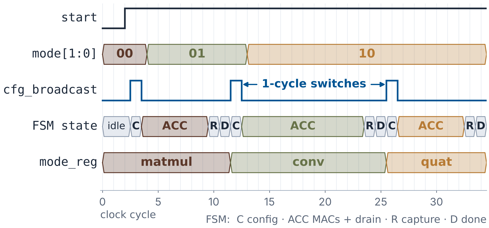

# SAGE-16

**A 16-DSP Reconfigurable Fabric for Edge Vision and Attitude Kernels**

SAGE-16 is a compact Artix-7 edge coprocessor that time-multiplexes three kernel
families — **3×3 convolution**, **matrix multiplication**, and **quaternion
Hamilton products** — on one shared 4×4 MAC array (16 DSP48E1 slices), with
**single-cycle kernel switching** via a 2-bit mode register and **no bitstream
reload**.

This repository contains the RTL, self-checking testbenches, training/export
scripts, and data needed to reproduce the RTL and FPGA results of our APCCAS 2026
paper (poster #2391, Fukuoka, 25–28 Oct 2026):

> Harshvardhan Mishra and Madhav Rao,
> *"SAGE-16: A 16-DSP Reconfigurable Fabric for Edge Vision and Attitude Kernels,"*
> to appear in IEEE Asia Pacific Conference on Circuits and Systems (APCCAS), 2026.

Came here from the poster's QR code? The poster is in
[`docs/APCCAS26_Poster_2391.pdf`](docs/APCCAS26_Poster_2391.pdf); the fastest check is
`scripts/run_sim.sh` (all quick testbenches in about 15 s, see [Quick start](#quick-start)).

## Highlights

| Metric | Value |
|---|---|
| DSP usage vs three separate kernel accelerators (same device) | 16 vs 48 (**−66.7%**); LUT 4879 vs 5234 (−6.8%) |
| Post-route Fmax estimate (xc7a35tcpg236-1, OOC) | **159.6 MHz** (see [Synthesis](#synthesis-vivado)) |
| Peak kernel throughput | 1.436 GMAC/s conv3×3 · 0.928 GMAC/s matmul / quaternion · 1.021 GMAC/s tiled matmul |
| Kernel switch | **1 configuration cycle**, no reset, no bitstream reload |
| Core power (Vivado vectorless estimate) | 0.188 W → 7.64 GMAC/s/W on conv3×3 |
| MNIST (MiniCNN-v2, INT4, full 10,000 images, RTL) | **95.04% top-1**, 49.09 M bit-exact checks, 0 mismatches |
| CIFAR-10 (VGG-BN v5, full 10,000-image export) | **87.69% fixed-point** (91.84% float); sampled RTL pass bit-exact |
| MNIST latency (fabric + software pooling) | 16 199 cycles/image → 101.5 µs at 159.6 MHz (the paper rounds the clock to 160 MHz: 101.2 µs); ~22× fewer cycles than the M4 (358 039) |
| Cortex-M4 cycle speedups (STM32G491; matmul 4×4, conv3×3 tile, quaternion batch) | 5.1–38.6× vs scalar · 8.2–29.7× vs CMSIS-DSP `SMLAD` |
| Cortex-M4 cycle speedups (quaternion vector rotation, two chained products) | 6.6× vs scalar · 7.9× vs `SMLAD` |
| Cortex-M4 cycle speedups (16×16 tiled matmul) | 60.5× vs scalar · 51.7× vs `SMLAD` (fabric cycles, host-side accumulation) |

Speedups are clock-cycle ratios (SAGE-16 at 159.6 MHz, M4 at 170 MHz) and count
raw fabric cycles from `start` to `done`; operand transfer through the MMIO / PCPI
wrappers is not included (see [Known limitations](#known-limitations)).

## How it works

**Fabric** (`rtl/sage16_4x4_mac.v`, `rtl/pe.v`). Sixteen PEs, each one DSP48E1:
a 17×17 signed multiply with input and product pipeline registers (`PIPELINE=1`)
feeding a 32-bit accumulator. (The paper's "signed 16×16 MAC": operands are 16-bit,
widened to 17 bits so unsigned 16-bit values also fit the signed DSP multiplier.) Signed vs. unsigned MAC is one opcode bit
(`OP_MACB` / `OP_MACB_S`). Operands arrive over two combinational broadcast
networks (fan-out 4):

* **row broadcast** (`in_bypass`): one value to all four PEs of row *i*;
* **column broadcast** (`in_b_col`): one value to all four PEs of column *j*;
* conv3×3 additionally uses a **per-PE bypass** path so each PE gets its own pixel.

Results stay in the PEs (output-stationary); all 16 accumulators are captured in
parallel in one cycle.

**Modes** (`rtl/sage16_top.v`, latched on `start`):

| `mode` | Kernel | Row / per-PE operand | Column operand | Opcode | Taps | Cycles |
|---|---|---|---|---|---|---|
| `00` | Matmul 4×4 (unsigned) | A[i][k] | B[k][j] | `OP_MACB` | 4 | 11 |
| `01` | Conv3×3, 4×4 output tile | own pixel I[r+di][c+dj] from a 6×6 patch | K[di][dj] (same for all 16) | `OP_MACB_S` | 9 | 16 |
| `10` | Quaternion batch | Q(q)[i][k] | p_j[k] | `OP_MACB_S` | 4 | 11 |
| `11` | Matmul 4×4 (signed), used for CNN FC layers | A[i][k] | B[k][j] | `OP_MACB_S` | 4 | 11 |

**Quaternion mode.** A quaternion q = w + xi + yj + zk encodes a 3-D orientation;
attitude filters (Madgwick, Mahony) update it with Hamilton products. The product
q ⊗ p equals Q(q)·p, where

```
Q(q) = [ w  -x  -y  -z ]
       [ x   w  -z   y ]
       [ y   z   w  -x ]
       [ z  -y   x   w ]
```

so mode `10` builds Q(q) combinationally, places four quaternions p₀…p₃ as the
columns of B, and reuses the matmul routing: column *j* of the result is q ⊗ p_j
(output transposed to `c_out[j*4+k]`). `quat_sage16.v` is literally
`matmul_sage16` with `OPCODE=OP_MACB_S`.

**Cycle accounting** (`start` → `done`, `PIPELINE=1`, as measured by the testbenches):

| Kernel | start latch | config broadcast + clear | MAC taps | DSP drain | capture | done / handshake | Total |
|---|---|---|---|---|---|---|---|
| matmul / quaternion | 1 | 1 | 4 | 2 | 1 | 2 | **11** |
| conv3×3 | 1 | 1 | 9 | 2 | 1 | 2 | **16** |

Only 4 of 11 (matmul) and 9 of 16 (conv) cycles issue MACs, so per-call control and
pipeline drain — not the array — bound throughput (tiled matmul: 6.4 of 16 MACs per
cycle, `MAC_eff=0.400`). Back-to-back kernels with a new `mode` reuse the `S_DONE`
cycle to broadcast the next configuration (`tb_reconfig_b2b`, `tb_reconfig_pairs`).



*`tb_reconfig_b2b`: `mode_reg` changes on a single `cfg_broadcast` cycle between kernels.*

## Repository layout

```
rtl/        Synthesizable RTL
              pe.v, sage16_4x4_mac.v        PE and 4x4 fabric
              sage16_top.v                  SHARED multi-kernel fabric (the paper's design)
              matmul_/conv3x3_/quat_sage16  single-kernel cores (separate-fabric baseline)
              sage16_mmio_top, _pcpi_top    host wrappers around sage16_top (all modes)
              sage16_mmio, _pcpi            older matmul-only wrappers
              sage16_sys.v                  PicoRV32 system top (needs picorv32.v, untested)
sim/        Self-checking testbenches for every RTL claim in the paper
scripts/    run_sim.sh / run_sim.bat, Vivado flow, training/export scripts
data/v2/    MiniCNN-v2 MNIST payload: INT4 weights + full 10,000-image test set
            + golden predictions (ready to run, no download needed)
docs/       CIFAR-10 train/export flow notes
```

The paper calls the separate-fabric baseline cores `matmul_cgra`, `conv3x3_cgra`
and `quat_cgra`; in this repository they are `matmul_sage16`, `conv3x3_sage16` and
`quat_sage16`.

## Quick start

Requirements: [Icarus Verilog](https://steveicarus.github.io/iverilog/) 11+
(`iverilog` / `vvp` on `PATH`). Tested with Icarus 12.0.

**Linux / macOS**

```bash
scripts/run_sim.sh                 # all quick testbenches (~15 s), exits non-zero on any failure
scripts/run_sim.sh matmul conv quat
scripts/run_sim.sh --list
```

**Windows** (`cmd` or PowerShell; the root `run_sim.bat` forwards to `scripts\run_sim.bat`)

```bat
run_sim.bat matmul   & REM 304 output cells
run_sim.bat conv     & REM Sobel/Laplacian/random kernels, 464 cells
run_sim.bat quat     & REM Hamilton products, 304 components
```

Every testbench is self-checking and ends with a `SUMMARY` line containing
`fail=0`.

## Reproducing the paper's claims

| Paper claim | Target | Expected result |
|---|---|---|
| Matmul kernel, 11 cycles | `matmul` | `pass=304 fail=0`, `cycles=11` |
| Conv3×3 kernel, 16 cycles | `conv` | `pass=464 fail=0`, `cycles/op=16` |
| Quaternion batch, 11 cycles | `quat` | `pass=304 fail=0`, `cycles/op=11` |
| Quaternion vector rotation, 22 cycles | `quat-vrot` | `cycles=22 pass=4 fail=0` |
| 8×8 / 16×16 tiled matmul, 80 / 640 cycles | `tiled` | `compute=80` / `compute=640`, `pass=320 fail=0` |
| Shared fabric, all three kernels | `reconfig` | 11 / 16 / 11 cycles, `pass=48 fail=0` |
| 1-cycle back-to-back switching | `b2b` | `pass=48 fail=0` |
| All 6 ordered mode transitions | `pairs` | `transitions: 6/6`, `pass=192 fail=0` |
| MMIO / PCPI host integration | `mmio_top` / `pcpi_top` | `pass=48 fail=0` each |
| Regression suite: 16 639 checks, 0 failures | all quick targets except `minicnn` | per-target `pass=` counts sum to 16 639 |
| **MNIST 95.04% top-1, full 10k, bit-exact** | `minicnn-v2-mnist` | `top-1: 9504/10000`, 0 mismatches |
| CIFAR-10 sampled RTL pass | see [CIFAR-10](#cifar-10-full-flow) | `pred matches export`, `fail=0` |

Part of the 16 639-check suite but not discussed individually in the paper:
`madgwick` (100-step Madgwick attitude filter on the fabric, `pass=100 fail=0`) and
`minicnn-v2` (synthetic weights, `pass=14727`). `minicnn` (v1, synthetic,
`pass=7047`) also runs in the default set but is not in that count.

**MNIST full run.** The 10,000-image test set and INT4 weights are bundled in
`data/v2/`; `tb_minicnn_v2.v` defaults to `N_IMG=10000` and checks every
intermediate tensor of every image (~49 M checks). In our Icarus 12 runs this
takes about 1.4 s per image, so roughly 4 hours for the full set and about 5
minutes for 200 images. For a quick look:

```bash
iverilog -g2012 -DREAL_MNIST -Ptb_minicnn_v2.N_IMG=200 -o build/mnist200.vvp \
  rtl/pe.v rtl/sage16_4x4_mac.v rtl/matmul_sage16.v rtl/sage16_top.v \
  sim/tb_minicnn_v2.v
vvp build/mnist200.vvp
```

The 95.04% is the accuracy of this deliberately small model (about 10 k INT4
weights, no biases); its training-time test accuracy in `data/v2/info.txt` is
also 0.9504, and the RTL reproduces the exported predictions exactly, so the
fabric adds no accuracy loss.

(`minicnn-mnist` targets the older v1 model and needs `data/images.mem`, which is
not committed; regenerate it with `python scripts/train_minicnn.py`.)

## CIFAR-10 full flow

The CIFAR-10 payload (~150 MB for 10k images) is not committed; it is
regenerated deterministically by two commands (requires Python 3 with
`torch`/`torchvision`; training takes a few GPU-hours, export takes minutes):

```bash
# 1) Train the float VGG-BN model (seed fixed for reproducibility)
python scripts/train_minicnn_cifar10.py --arch v5 --float-only --epochs 60 \
  --lr 0.05 --batch 128 --w_max 15 --conv2_shift 3 --weight_decay 0.0005 \
  --label_smoothing 0.05 --export 0 --seed 1 \
  --save-checkpoint checkpoints/cifar_v5_float60_seed1.pt

# 2) Fold BN, calibrate fixed-point shifts, export the full 10k test set
python scripts/train_minicnn_cifar10.py --arch v5 \
  --load-checkpoint checkpoints/cifar_v5_float60_seed1.pt \
  --epochs 0 --relaxed-epochs 0 --quant-epochs 0 --lr 0.05 --batch 128 \
  --w_max 15 --conv2_shift 3 --weight_decay 0.0005 --label_smoothing 0.05 \
  --shift-sweep --sweep-conv2 4:10 --sweep-pool1 0:4 --sweep-pool2 0:4 \
  --sweep-gap 0:5 --sweep-samples 5000 --export 10000
```

Step 2 writes `data/cifar10_v5/` and prints the summary; `info.txt` should
report `export_acc: 0.8769` (87.69% on the full 10,000-image test set,
`best_float_acc: 0.9184`). Then run the sampled RTL validation:

```bash
iverilog -g2012 -DREAL_CIFAR10_V5 -Ptb_cifar10_v5.N_IMG=16 \
  -o build/cifar16.vvp \
  rtl/pe.v rtl/sage16_4x4_mac.v rtl/matmul_sage16.v rtl/sage16_top.v \
  sim/tb_cifar10_v5.v
vvp build/cifar16.vvp
```

The testbench needs the `data/cifar10_v5/` files written by step 2. It replays the exported fixed-point inference on the SAGE-16 fabric
and checks each prediction against the exported `preds.txt`
(`pred matches export : N / N`). The paper's RTL pass covers 64 images; the
87.69% figure is the exported fixed-point model on all 10,000 images, which the
RTL reproduces bit-exactly on every image simulated. Each CIFAR image is ~48 M
fabric cycles, so budget simulation time accordingly (`cifar10-v5-smoke` runs 2
images).

## Synthesis (Vivado)

Results in the paper use Vivado 2025.1, out-of-context, xc7a35tcpg236-1:

```bat
REM single top (module, clock period ns, mode)
vivado -mode batch -source scripts\synth_top.tcl -tclargs sage16_top 5.000 ooc

REM all paper-relevant tops (shared fabric + separate baselines + wrappers)
cmd /c scripts\synth_all.bat
python scripts\parse_reports.py
```

Designs are constrained at 5.000 ns (200 MHz) and **do not close timing there**;
`parse_reports.py` reports the achievable Fmax as `1000 / (period − WNS)`, which
gives the 159.6 MHz (core), 162.5 MHz (+MMIO) and 156.4 MHz (+PCPI) figures in the
paper. `synth_all.bat` also synthesizes the three kernel-specific cores separately —
the internal baseline behind the 66.7% DSP / 6.8% LUT comparison.

## Cortex-M4 baselines

Embedded baselines were measured on an STM32G491 (Cortex-M4F, 170 MHz,
`arm-none-eabi-gcc -O3`, DWT cycle counter, median of 100 runs) using the same
integer tensors as the RTL testbenches, in scalar and CMSIS-DSP `SMLAD` variants.
**The firmware is not part of this repository**, so the M4 numbers cannot yet be
reproduced from it; the matched operand headers can be regenerated with
`scripts/export_v2_mem_to_c.py` and `scripts/export_cifar10_mem_to_c.py`.

## Known limitations

* **Operand transfer is not in the kernel cycle counts.** Through `sage16_mmio_top`,
  a 4×4 matmul also needs 32 operand writes and 16 result reads around the 13-cycle
  go→done window; at single-tile granularity this dominates.
* **Tiled matmul** is driven from host software: partial sums are accumulated
  outside the fabric, and the 80 / 640 cycle figures are fabric-busy cycles
  (end-to-end in the testbench: 88 / 704).
* **Pooling, normalization and data movement** in the CNN pipelines run in
  software (28% of MNIST cycles per image).
* The N/S/E/W mesh and per-PE operand muxes in `sage16_4x4_mac.v` are not used by
  the `sage16_top` kernels (every operand arrives over a broadcast or the conv
  per-PE path), and `ext_out_east` is left unconnected there; results are read
  from `all_pe_out`.
* Power figures are Vivado vectorless estimates, not board measurements.
* `sage16_sys.v` requires `picorv32.v` (not vendored) and has no testbench.

## License

Released under the [MIT License](LICENSE).

## Citation

```bibtex
@inproceedings{mishra2026sage16,
  author    = {Mishra, Harshvardhan and Rao, Madhav},
  title     = {{SAGE-16}: A 16-{DSP} Reconfigurable Fabric for Edge Vision and Attitude Kernels},
  booktitle = {IEEE Asia Pacific Conference on Circuits and Systems (APCCAS)},
  year      = {2026},
  note      = {to appear}
}
```
